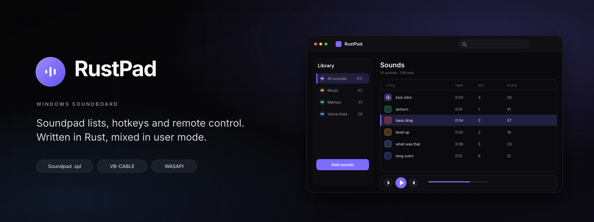
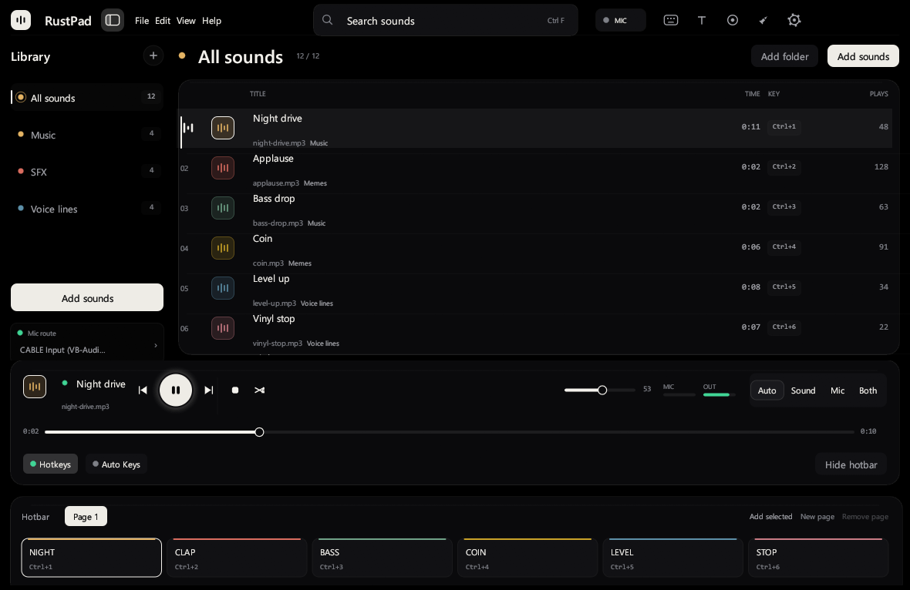
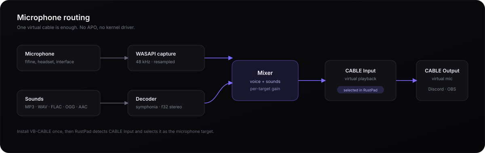
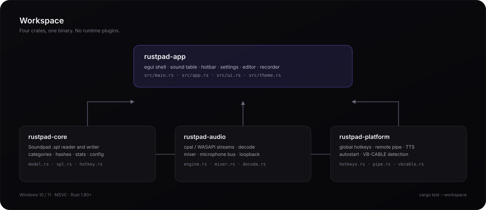

<p align="center">
  
</p>

RustPad is a soundboard for Windows, written in Rust. It reads Soundpad 4.x `.spl` lists,
plays common audio formats, and sends the mix to your speakers or to a virtual microphone
cable for Discord, OBS and games.

It is a native desktop application. No Electron, no installer, no kernel driver, no Steam.

[Build](#build) · [Screenshots](#screenshots) · [Microphone routing](#microphone-routing) · [Remote control](#remote-control)

## Status

Windows 10/11, x86_64 MSVC. The project is usable but still alpha; the sound list and audio
engine are covered by **83 tests**, the UI is checked manually.

## Screenshots



The main view during playback: category sidebar, sound table, transport, output and microphone
meters, and a six-cell hotbar. The screenshot uses a demo library, not a customer list.

## What works

- **Sound lists.** Reads and writes Soundpad `.spl` files, including categories, icons,
  colors, custom tags, hotbar pages and `stats.spl` play counts. Unknown attributes are kept.
  Sound identity follows Soundpad's document-order rule, and the file hash uses the real
  volume-serial + NTFS file-id tuple, so play counts survive edits.
- **Audio.** WAV, MP3, FLAC, OGG-Vorbis and AAC/M4A through symphonia; runtime resampling,
  polyphonic mixing, seek, pause, previous/next/random, master and per-target volume.
  Starting a new sound stops the previous one by default; overlapping playback is a setting.
- **Routing.** Speakers, microphone cable, or both. Microphone passthrough with gain and
  optional delay; the voice is mixed with sounds by default and can be muted during playback
  if you prefer.
- **Hotkeys.** Per-sound keys, push-to-talk modifiers, `Ctrl+1..0` index keys, numpad keys,
  hotkey capture and an overview window. Hotkeys are observed, never swallowed.
- **Auto Keys.** Holds a configured key and modifiers with `SendInput` while a sound plays,
  optionally only for hotkey-triggered playback.
- **Hotbar.** Pages, six-column grid, per-cell colors and hotkeys.
- **Extras.** Recorder (microphone or WASAPI loopback), waveform editor, SAPI text-to-speech,
  loudness normalization, drag and drop, English/Russian UI.
- **Remote control.** The Soundpad named pipe, command names and response framing, plus a
  command-line client.

## Microphone routing

Windows does not let a normal application inject audio into another application's microphone.
Soundpad solves this with a signed APO driver. RustPad uses a virtual cable instead, which
needs no driver signing.



1. Install [VB-CABLE](https://vb-audio.com/Cable/) once. RustPad can download and start the
   installer from the microphone setup window.
2. In RustPad, set **Microphone output** to `CABLE Input (VB-Audio Virtual Cable)`. A physical
   microphone is selected as the capture device automatically; the app never defaults the
   capture side to a virtual cable.
3. In Discord, OBS or the game, select `CABLE Output (VB-Audio Virtual Cable)` as the
   microphone.
4. Disable noise suppression, echo cancellation and automatic gain control for that input.
   They tend to gate a quiet USB microphone.

The microphone and the soundboard are now mixed into the same virtual microphone. The footer
in RustPad shows the selected cable; the `MIC` indicator in the top bar follows the capture
level.

## Build

Requirements:

- Windows 10 or 11
- Rust 1.80+ with the `x86_64-pc-windows-msvc` toolchain
- Visual Studio Build Tools with the C++ workload

```powershell
git clone https://github.com/panchisk/rustpad.git
cd rustpad
cargo test --workspace
cargo build --release
.\target\release\rustpad.exe
```

The result is a single executable. Settings live in `%APPDATA%\RustPad\config.json`.

## Remote control

RustPad serves the same named pipe as Soundpad:

```text
\\.\pipe\sp_remote_control
```

Commands can be sent through the pipe, or with the command-line client:

```powershell
rustpad.exe -rc "DoPlaySound(1)"
rustpad.exe -rc "DoPlaySoundFromCategory(2,1,true,false)"
rustpad.exe -rc "GetSoundFileCount()"
```

Supported commands include `DoPlaySound`, `DoPlaySoundFromCategory`, `DoPlayRandomSound`,
`DoPlayRandomSoundFromCategory`, `DoPlayPreviousSound`, `DoPlayNextSound`,
`DoPlaySelectedSound`, `DoPlayCurrentSoundAgain`, `DoPlayPreviouslyPlayedSound`,
`PauseResume`, `Stop`, `DoAddSound`, `DoRemoveSelectedEntries`, `DoRemoveCategory`,
`DoSaveSoundlist`, `GetSoundFileCount`, `GetSoundlist`, `GetVersion` and
`GetRemoteControlVersion`.

Responses use Soundpad's framing: optional payload lines followed by `R0` on success,
`R-204` for a malformed call, `R-404` for an unknown command.

## Project layout



| Crate | Contents |
|---|---|
| `rustpad-core` | `.spl` model and parser, categories, hashes, stats, config, hotkey types |
| `rustpad-audio` | cpal/WASAPI streams, decoding, resampling, mixer, microphone bus, loopback |
| `rustpad-platform` | global hotkeys, remote-control pipe, TTS, autostart, VB-CABLE detection |
| `rustpad-app` | egui shell, sound table, hotbar, settings, editor, recorder |

## Compatibility notes

- `.spl` files are read and written with the observed Soundpad schema; unknown attributes are
  preserved. `altCode` is preserved but not interpreted.
- Opus decoding is disabled. WAV, MP3, FLAC, OGG-Vorbis and AAC are supported.
- Loopback recording captures the default output mix, not individual applications.
- Microphone injection requires a virtual cable. Without one, other applications hear only
  the physical microphone.
- There is no DRM or licensing integration. Every feature works without Soundpad installed.

## License

MIT. See [LICENSE](LICENSE).

Soundpad is a product of Leppsoft. This project contains no Leppsoft code or assets.
